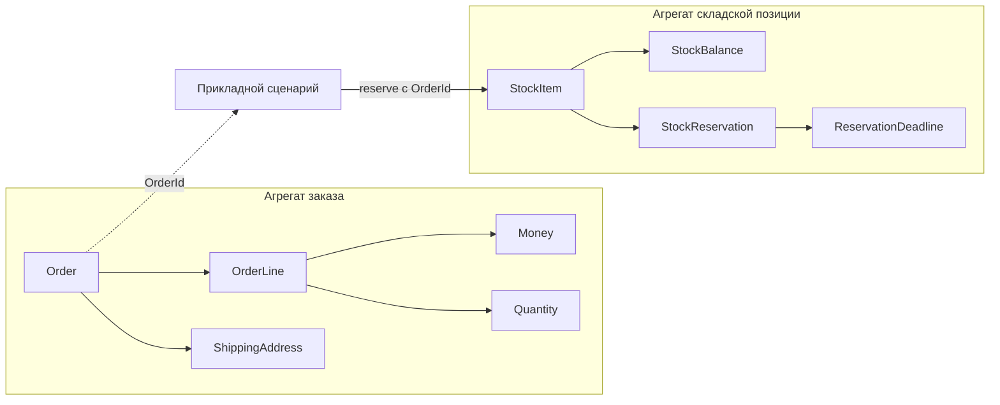
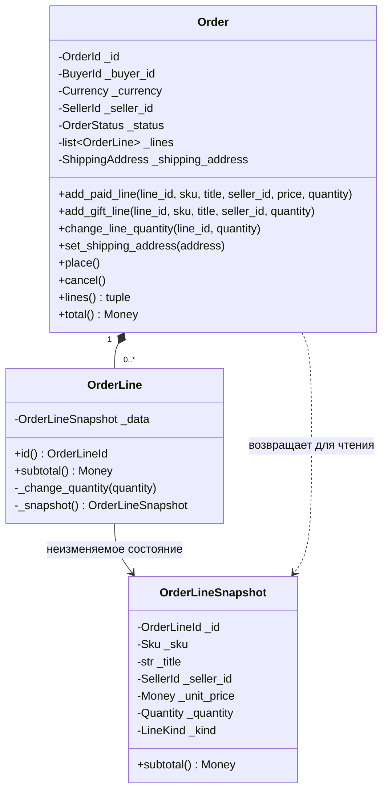
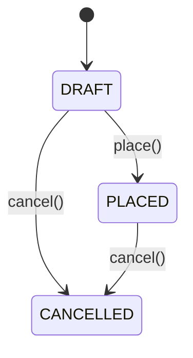
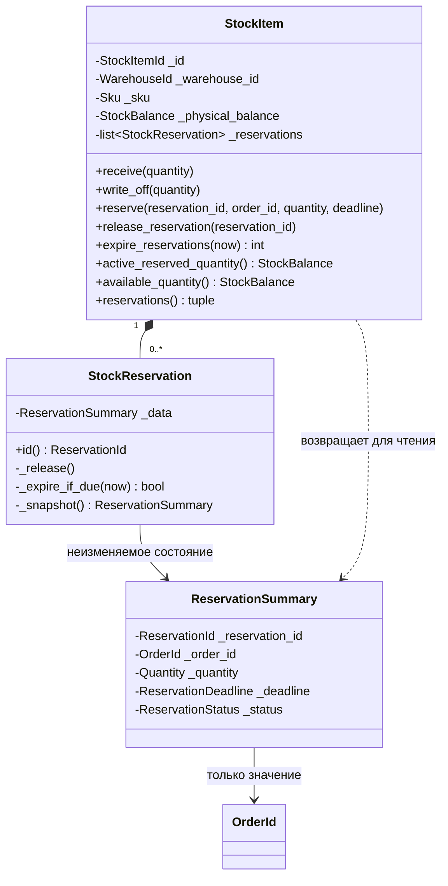
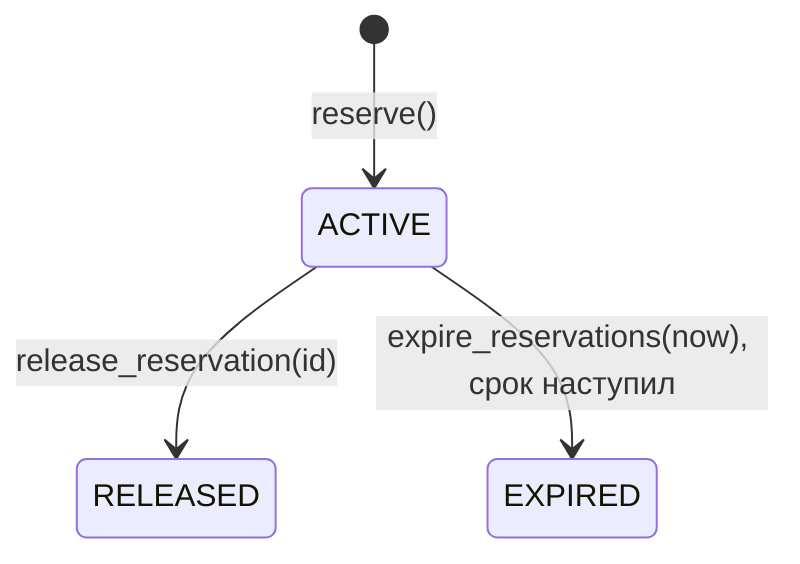
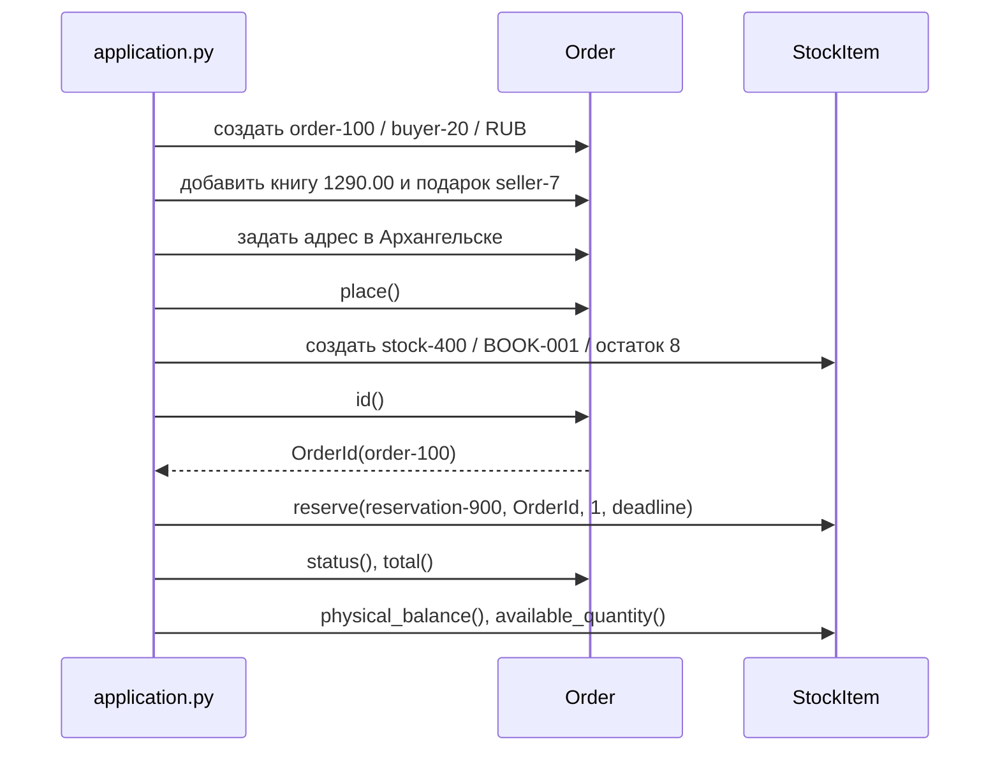

# Итоговая модель двух агрегатов магазина «Север»

`Order` отвечает за состав и состояние одного заказа. `StockItem` отвечает за
физический остаток и резервы одного SKU на одном складе. Между ними нет общей
изменяемой части: прикладной сценарий передаёт только значение `OrderId`.

## Границы и состав



Внешние покупатель и продавец представлены `BuyerId` и `SellerId`, склад —
`WarehouseId`, товар — `Sku`. Их самостоятельные модели не загружаются.

## Значения и идентичность

- `Identifier` и его подклассы: OrderId, OrderLineId, BuyerId, SellerId, StockItemId, WarehouseId, ReservationId.
- `Sku` — непустой код товара; `Currency` — три латинские буквы, нормализуемые в верхний регистр.
- `Quantity` — положительное целое; `StockBalance` — неотрицательное целое. bool не считается количеством.
- `Money` — конечный неотрицательный Decimal и Currency. Сложение требует одинаковой валюты, умножение принимает Quantity.
- `ShippingAddress` — непустые город, улица, дом и индекс.
- `ReservationDeadline` — datetime с часовым поясом; `is_due(now)` проверяет срок <= now.

Значения неизменяемы, равенство и хеш учитывают конкретный тип и содержимое.
`ImmutableValue` — общая примесь блокировки присваивания/удаления полей, равенства,
хеша и представления; конкретные значения задают `_parts()`. Значения создаются
явными конструкторами, без dataclass и property.

## Order



Создание: `Order(OrderId, BuyerId, Currency)`. Запросы: `id()`, `buyer_id()`,
`currency()`, `status()`, `seller_id()`, `lines()`, `shipping_address()`, `total()`.
Пустой черновик имеет продавца и адрес `None`. `total()` пустого заказа — ноль в
его валюте. Итог вычисляется, отдельного изменяемого поля суммы нет.

OrderLine — внутренняя сущность с устойчивым ID. Она хранит текущее состояние
в неизменяемом OrderLineSnapshot и заменяет этот снимок при изменении количества.
Поэтому уже выданный снимок сохраняет прежнее значение; изменение сущности не
означает изменение внешнего представления. `lines()` возвращает кортеж снимков.

### Инварианты

1. Строки имеют уникальные OrderLineId; одинаковые SKU не запрещены.
2. Валюта строки совпадает с валютой заказа; цена зафиксирована при добавлении.
3. Первая успешная строка определяет продавца, остальные имеют тот же SellerId.
4. PAID имеет цену > 0, GIFT — ровно 0; корень сам создаёт цену подарка в своей валюте.
5. Добавление строк, изменение количества и адреса разрешены только в DRAFT.
6. place требует DRAFT, строки, адрес, хотя бы одну PAID и положительную сумму.
7. cancel переводит DRAFT или PLACED в CANCELLED; повторный вызов отклоняется.
8. Все предусловия проверяются до изменения наблюдаемого состояния.

| Команда | Проверки до изменения | Результат |
|---|---|---|
| add_paid_line | DRAFT, корректные значения, новый ID, валюта, продавец, положительная цена | Добавлена PAID |
| add_gift_line | DRAFT, корректные значения, новый ID, продавец | Добавлена GIFT с ценой ноль |
| change_line_quantity | DRAFT, корректные ID и Quantity, строка найдена | Новое количество конкретной строки |
| set_shipping_address | DRAFT, ShippingAddress | Адрес заменён целиком |
| place | Полнота заказа и черновой статус | PLACED, состав и адрес прежние |
| cancel | Статус не CANCELLED | CANCELLED |



## StockItem



Создание: `StockItem(StockItemId, WarehouseId, Sku, StockBalance)`. Дополнительные
запросы: `id()`, `warehouse_id()`, `sku()`, `physical_balance()`.
Все запросы количеств возвращают StockBalance, допускающий ноль; число читается
через `.value()`. `reservations()` возвращает кортеж ReservationSummary.

StockReservation — внутренняя сущность; смена состояния заменяет её неизменяемую
сводку. Ранее возвращённая сводка остаётся прежней. Корень не возвращает внутренние
сущности и не принимает объект Order.

### Инварианты и команды

```text
R = сумма Quantity всех резервов со статусом ACTIVE
P = физический остаток
A = доступный остаток = P − R
P >= 0; R <= P; A >= 0
```

| Команда | Проверки до изменения | Постусловие |
|---|---|---|
| receive(q) | q — Quantity | P увеличен на q, резервы прежние |
| write_off(q) | q — Quantity, q <= A | P уменьшен на q, P >= R |
| reserve(id, order_id, q, deadline) | Типы, ID уникален среди всех записей, q <= A | Новый ACTIVE, P прежний, A уменьшен |
| release_reservation(id) | ID найден, резерв ACTIVE | RELEASED, P прежний, запись сохранена |
| expire_reservations(now) | now содержит часовой пояс | ACTIVE с deadline <= now становятся EXPIRED; возвращается число переходов |



RELEASED и EXPIRED не уменьшают доступность и не удаляются. ID завершённого резерва
не используется повторно. Повторное освобождение — ошибка, повторная обработка
истечения с тем же временем без новых подходящих резервов возвращает 0.
Истечение вызывается явно; ни один запрос не читает часы и не меняет статус.

## Доменная ошибка и сохранение состояния

`DomainError` — общий базовый тип. `InvalidValueError` обозначает неверное значение
или тип. Отказы заказа: OrderStateError, IncompleteOrderError,
CurrencyMismatchError, SellerMismatchError, DuplicateOrderLineError,
OrderLineNotFoundError. InsufficientStockError относится к доступному остатку.
ReservationError объединяет DuplicateReservationError, ReservationNotFoundError
и ReservationStateError.

После доменного отказа состояние остаётся прежним: проверки выполняются перед
присоединением строки/резерва и перед заменой статуса или баланса.

## Прикладная последовательность



Результат: PLACED, 1290.00 RUB, физически 8, доступно 7. `run_demo()` возвращает
текст, `main()` печатает его и возвращает 0. Строки и резервы создаются корнями.
Если отдельный reserve отклонён, ранее размещённый заказ автоматически не отменяется.
Хранение, платежи, доставка, конкурентный доступ и компенсации не моделируются.

## Как модель росла

| Этап | Изменение | Сохраняемое правило |
|---|---|---|
| 1 | Order, значения, строка с ID, снимок | Валюта, полнота, статус, отказ без изменения |
| 2 | SellerId | Один продавец, уникальные ID строк |
| 3 | LineKind и две команды добавления | Нулевая цена подарка, обязательная платная часть |
| 4 | StockItem и StockBalance | Неотрицательный физический остаток |
| 5 | Внутренние резервы и сводки | Активные резервы <= физический остаток |
| 6 | EXPIRED и обработка времени | Истекают только активные с наступившим сроком |

Сигнатуры предыдущих этапов заменены итоговыми; временной публичной add_line нет.
Фактические результаты промежуточных запусков находятся в [evolution.md](evolution.md).
