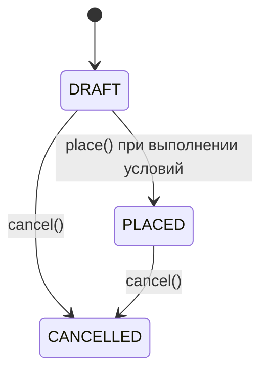
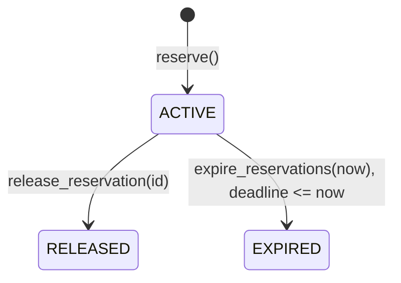
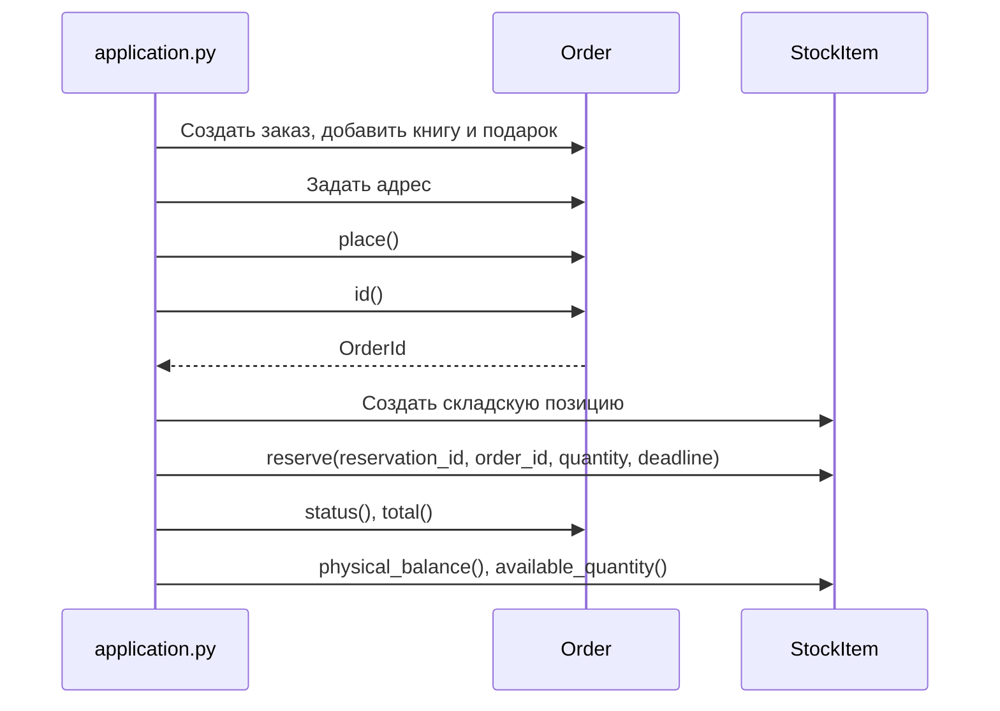

# DDD и агрегаты: конспект к лабораторной «Два агрегата магазина „Север“»

Этот конспект объясняет тему и требования лабораторной. Он не является реализацией задания: исходный код и тесты каркаса не изменены. Короткие примеры ниже иллюстрируют правила, а не образуют готовую программу.

Материалы рассматривают несколько последовательных версий модели. Здесь итоговый контракт лабораторной описан по практикуму и документации каркаса; отличия лекционных примеров разобраны в разделе 17.

## Содержание

1. [Материалы и порядок чтения](#1-материалы-и-порядок-чтения)
2. [Главная идея DDD](#2-главная-идея-ddd)
3. [Основные термины](#3-основные-термины)
4. [Сущности, значения и идентификаторы](#4-сущности-значения-и-идентификаторы)
5. [Как выбрать границу агрегата](#5-как-выбрать-границу-агрегата)
6. [Инварианты и команды](#6-инварианты-и-команды)
7. [Значения и проверки в Python](#7-значения-и-проверки-в-python)
8. [Агрегат заказа Order](#8-агрегат-заказа-order)
9. [Агрегат складской позиции StockItem](#9-агрегат-складской-позиции-stockitem)
10. [Связь агрегатов и демонстрация](#10-связь-агрегатов-и-демонстрация)
11. [Как читать диаграммы](#11-как-читать-диаграммы)
12. [Шесть этапов лабораторной](#12-шесть-этапов-лабораторной)
13. [Тесты как проверка бизнес-правил](#13-тесты-как-проверка-бизнес-правил)
14. [Файлы проекта и документация](#14-файлы-проекта-и-документация)
15. [Развитие модели и типичные ошибки](#15-развитие-модели-и-типичные-ошибки)
16. [Вопросы для самопроверки и защиты](#16-вопросы-для-самопроверки-и-защиты)
17. [Различия и неточности материалов](#17-различия-и-неточности-материалов)
18. [Чек-лист готовности](#18-чек-лист-готовности)
19. [Краткая памятка](#19-краткая-памятка)

## 1. Материалы и порядок чтения

| Источник | Что в нём искать |
|---|---|
| [Лекция: тактическое проектирование агрегатов](./lecture-02-tactical-aggregates.pdf) — 81 страница | Объяснения сущностей, значений, инвариантов, границ, снимков и предметных команд. Антипримеры, вопросы, варианты развития модели |
| [Эволюция двух агрегатов](./north-two-aggregates-evolution.pdf) — 76 страниц | Шесть последовательных версий: бизнес-ситуация, состав, правило, самостоятельный листинг и негативный сценарий |
| [Практикум](./north-two-aggregates-practicum.pdf) — 20 страниц | Точное задание, ограничения, публичные методы, порядок работы и критерии готовности |
| [Модель стартового проекта в PDF](./north-two-aggregates-starter-model.pdf) — 14 страниц | Состав итоговых агрегатов, связи, состояния и команды |
| [Карта реализации в PDF](./north-two-aggregates-starter-evolution.pdf) — 5 страниц | Какие типы, файлы и тесты относятся к каждому этапу; шаблон журнала |
| [README каркаса](./north-two-aggregates-starter/README.md) | Назначение проекта, команды запуска и ограничения |
| [model.md](./north-two-aggregates-starter/model.md) | Текстовая версия целевой модели с Mermaid-диаграммами |
| [evolution.md](./north-two-aggregates-starter/evolution.md) | План этапов и форма записей о выполнении |

Для первого знакомства прочитай разделы 2–10 этого конспекта. Перед разработкой — разделы 12–14 и практикум. Для подготовки к защите — разделы 15–19.

Ориентиры в практикуме: страницы 4–9 — цель, контракт и демонстрация; 10–12 — рабочий процесс; 13–18 — шесть этапов; 19–20 — состав сдаваемой работы и готовность. В лекции основная теория начинается на странице 5, разбор склада — на 34, тестирование и развитие модели — на 63–73, контрольные вопросы — на 78.

В лекции упоминаются книги Эрика Эванса, Вона Вернона и Влада Хононова. Этот конспект составлен по предоставленным учебным материалам, а не по самостоятельному чтению этих книг. Их названия приведены в библиографии лекции для дальнейшего изучения.

## 2. Главная идея DDD

**DDD — Domain-Driven Design, предметно-ориентированное проектирование.** Код строят вокруг понятий и правил предметной области: заказа, строки, цены, резерва, размещения, отмены.

Вместо вопроса «какие поля создать?» сначала спрашивают:

1. Что происходит в предметной области?
2. Какие состояния допустимы?
3. Кто располагает данными, чтобы проверить правило?
4. Какая операция должна принять или отклонить изменение?

Например, покупатель выбирает книгу за 1500 рублей. Затем продавец меняет цену витрины на 1700 рублей. Должна ли измениться цена уже добавленной строки заказа? В учебной модели — нет: строка хранит согласованную цену на момент добавления. Это предметное правило, которое должно определять устройство кода.

Единый язык помогает говорить об одном и том же в задании, диаграмме, методе и тесте. Фраза «разместить полный заказ» превращается в `Order.place()`. Фраза «удержать товар для заказа» — в `StockItem.reserve(...)`.

**Тактическое проектирование** здесь означает выбор сущностей, объектов-значений, агрегатов и их методов. Ограниченный контекст — более широкая граница смысла модели: одно слово в каталоге и заказах может означать разные вещи. Контекст и агрегат не равнозначны; в контексте может быть несколько агрегатов.

Лабораторная сосредоточена на двух небольших границах и их локальных правилах. Полноценный маркетплейс, взаимодействие сервисов и хранение данных в неё не входят.

## 3. Основные термины

| Термин | Значение | Пример |
|---|---|---|
| Предметная модель / Domain Model | Понятия и поведение, выражающие правила области | Заказ принимает строки и разрешает размещение |
| Сущность / Entity | Объект, который узнают по устойчивой идентичности при изменении его данных | Заказ остаётся тем же после смены адреса |
| Идентичность / Identity | Ответ на вопрос «это всё ещё тот же объект?» | Непрерывность жизни конкретного заказа |
| Идентификатор / Identifier | Значение, выражающее идентичность | `OrderId("order-100")` |
| Объект-значение / Value Object | Объект без собственной биографии, определяемый содержимым | `Money`, `Quantity`, `ShippingAddress` |
| Агрегат / Aggregate | Группа объектов, общие правила которой защищаются через один корень | Заказ и его строки |
| Корень агрегата / Aggregate Root | Единственная поддерживаемая внешняя точка изменения агрегата | `Order`, `StockItem` |
| Граница агрегата / Aggregate Boundary | Предел состояния, за согласованность которого отвечает корень | Строки внутри заказа, склад снаружи |
| Внутренняя сущность | Сущность, изменяемая через корень и принадлежащая его границе | `OrderLine`, `StockReservation` |
| Композиция / Composition | Владение внутренними частями | `Order` содержит `OrderLine` |
| Инкапсуляция / Encapsulation | Сокрытие изменяемого состояния за разрешёнными операциями | Добавление строки через метод, а не через `append` снаружи |
| Инвариант / Invariant | Условие, сохраняющееся после каждой успешной команды | Активные резервы не превышают физический остаток |
| Предусловие / Precondition | Условие допустимости операции до изменения | Для добавления строки нужен `DRAFT` |
| Постусловие / Postcondition | Гарантируемый результат операции | После успешного `place()` статус равен `PLACED` |
| Команда / Command | Запрос предметного изменения | `receive`, `cancel`, `reserve` |
| Запрос / Query | Чтение без изменения состояния | `total()`, `status()`, `available_quantity()` |
| Публичный контракт | Доступные конструкторы, команды и запросы | API класса `Order` |
| Жизненный цикл / Lifecycle | Состояния и допустимые переходы | `ACTIVE → RELEASED` или `EXPIRED` |
| Снимок / Snapshot | Зафиксированное значение или представление для чтения | Цена при добавлении, снимок строки |
| Доменная ошибка | Отказ с предметным смыслом | `SellerMismatchError` |
| Атомарность команды | Команда не оставляет частично изменённый объект при отказе | Другая валюта отклонена, состав прежний |
| Ссылка по идентификатору | Значение ID вместо чужого изменяемого объекта | `OrderId` внутри резерва |
| Прикладной сценарий | Последовательность вызовов готовых корней | Разместить заказ, затем создать резерв |
| Локальная согласованность | Корень немедленно обеспечивает правила своей границы | Заказ сразу отклоняет другого продавца |
| Конечная согласованность / Eventual Consistency | Согласование самостоятельных границ со временем | Тема за пределами реализации этой лабораторной |

## 4. Сущности, значения и идентификаторы

### 4.1. Как отличить сущность от значения

Два заказа могут иметь одинаковые строки, адрес и сумму, но быть разными заказами. Их различает `OrderId`. Если у одного заказа поменялся адрес, он не становится другим заказом.

Две суммы `Money(100, RUB)` равны по содержанию. Им не нужны индивидуальные номера и история жизни. Чтобы получить 150 рублей, создают другое значение, а не меняют старое, которое уже используется строкой.

Практический вопрос: **нужно ли отслеживать именно этот объект после изменения его свойств?** Если да — вероятна сущность. Если достаточно содержания — вероятен объект-значение. Решение зависит от модели, а не от числа полей.

### 4.2. Классификация типов лабораторной

| Роль | Типы |
|---|---|
| Корни и одновременно сущности | `Order`, `StockItem` |
| Внутренние сущности | `OrderLine`, `StockReservation` |
| Типизированные идентификаторы | `OrderId`, `OrderLineId`, `BuyerId`, `SellerId`, `StockItemId`, `WarehouseId`, `ReservationId` |
| Объекты-значения | `Sku`, `Currency`, `Quantity`, `StockBalance`, `Money`, `ShippingAddress`, `ReservationDeadline` |
| Неизменяемые снимки для чтения | `OrderLineSnapshot`, `ReservationSummary` |
| Перечисления | `OrderStatus`, `LineKind`, `ReservationStatus` |

`Sku` описывает код товара, а `OrderLineId` — конкретную строку. Две строки могут ссылаться на один SKU и иметь разные идентификаторы. Нельзя подменять требование уникальности `OrderLineId` неоговорённым запретом повторяющихся SKU.

### 4.3. Зачем отдельные классы идентификаторов

Строки `"100"` для покупателя, заказа и склада выглядят одинаково, но имеют разный смысл. `BuyerId("100")` и `OrderId("100")` позволяют выразить это различие в API и проверках. Типизированные ID проверяют допустимость значения и защищают от смешения предметных ролей.

Идентификатор сам является значением. Хранение `BuyerId` в заказе не означает включение профиля покупателя в агрегат.

У `StockReservation` есть два разных ID:

- `ReservationId` отвечает: «какой резерв изменить?»;
- `OrderId` отвечает: «для какого заказа создан этот резерв?».

### 4.4. Внутренняя сущность не обязана быть корнем

Строка имеет ID, потому что нужно изменить количество именно в ней. Но решение о допустимости изменения зависит от статуса заказа, поэтому внешний код вызывает `Order.change_line_quantity(...)`.

Резерв имеет ID и меняет статус, но возможность его создания зависит от всех резервов и остатка позиции. Поэтому им управляет `StockItem`.

## 5. Как выбрать границу агрегата

Граница определяется данными, которые нужны для немедленного соблюдения правила. Она не обязана совпадать с экраном, таблицей, пакетом Python или всем магазином.

```text
Заказ Order                         Складская позиция StockItem
├── OrderId, BuyerId                 ├── StockItemId, WarehouseId, Sku
├── валюта и продавец                ├── физический остаток
├── статус                          └── внутренние резервы
├── адрес                               ├── ReservationId
└── внутренние строки                   ├── OrderId — только значение
    ├── OrderLineId                     ├── количество и срок
    ├── Sku, название, продавец         └── статус
    └── цена, количество, вид
```

Чтобы проверить единую валюту, заказу нужны его валюта и строки. Чтобы проверить единого продавца — продавцы строк. Чтобы разместить заказ — строки, сумма, адрес и статус. Эти данные находятся внутри `Order`.

Чтобы создать резерв, нужны физический остаток и уже активные резервы. Адрес покупателя для этого не нужен. Поэтому остаток и резервы находятся в `StockItem`.

Каталог, профиль покупателя, оплата и доставка имеют собственные правила и жизненные циклы. Заказ сохраняет нужные факты или идентификаторы, а не получает право менять всё связанное с покупкой.

**Малый агрегат** — небольшая область обязательной согласованности, а не обязательно маленькое число классов. Один гигантский класс может захватывать несколько чужих границ.

## 6. Инварианты и команды

### 6.1. Кому принадлежит правило

| Правило | Кто его проверяет | Почему |
|---|---|---|
| Количество — положительное целое | `Quantity` | Достаточно одного значения |
| Сумма конечна и неотрицательна | `Money` | Это допустимость самой денежной суммы |
| Код валюты состоит из трёх букв | `Currency` | Это форма кода |
| Все строки имеют валюту заказа | `Order` | Нужно сравнить несколько частей |
| Все строки одного продавца | `Order` | Отдельная строка не видит остальных |
| Платная строка имеет положительную цену | Правило `OrderLine`, создаваемой корнем | Связь вида строки и её цены |
| При размещении есть платная строка и адрес | `Order` | Нужен весь состав заказа |
| Физический остаток неотрицателен | `StockBalance` и команды склада | Значение не допускает отрицательного результата |
| Активные резервы не больше остатка | `StockItem` | Нужны остаток и все резервы |
| Срок задаёт однозначный момент | `ReservationDeadline` | Нужен часовой пояс |
| Истекает только активный резерв с наступившим сроком | Резерв под управлением `StockItem` | Учитываются статус и дедлайн |

Корень может поручать внутренней сущности её локальный переход. Требование «изменять через корень» не означает, что весь код обязан находиться в одном методе корня.

### 6.2. Предусловия и постусловия

Для добавления платной строки:

- До изменения: заказ — черновик, ID строки новый, продавец и валюта подходят, значения допустимы.
- После успеха: появилась строка, её сумма входит в итог, общие правила сохранены.
- После отказа: строки, итог, продавец и статус остались прежними.

Для размещения:

- До изменения: `DRAFT`, непустой состав, адрес, платная строка, положительный итог.
- После успеха: `PLACED`, состав и адрес прежние.
- После отказа: заказ остаётся прежним черновиком.

Не каждое условие требуется во всех состояниях. Пустой черновик допустим. Недопустим **размещённый** заказ без строк. Поэтому «заказ всегда непустой» — неверная формулировка инварианта этой модели.

### 6.3. Сначала проверки, потом изменение

Правильный порядок: проверить статус → проверить все ограничения новой строки → добавить строку.

Опасный порядок: добавить строку → обнаружить несовпадение → выбросить исключение. Исключение само по себе не отменяет уже выполненное изменение.

В этой лабораторной атомарность означает отсутствие частичных изменений при доменном отказе. Она не доказывает потокобезопасность, наличие транзакции БД или атомарность последовательности `place()` и `reserve()`.

## 7. Значения и проверки в Python

### 7.1. Неизменяемость и инкапсуляция

Объект-значение проверяется при создании, сравнивается по содержимому и заменяется целиком при изменении. Идентификаторы и снимки также должны сохранять своё значение.

В Python `_lines` означает непубличную часть API по соглашению. Одно подчёркивание не делает объект технически неизменяемым. Для снимков важно обеспечить предусмотренную контрактом неизменяемость и не раскрывать изменяемые внутренние сущности.

Кортеж решает только вопрос изменения коллекции. Если внутри него лежат изменяемые `OrderLine`, внешний код всё ещё может изменить строку. Поэтому `lines()` возвращает кортеж **снимков**, а не кортеж внутренних строк. Аналогично устроен `reservations()`.

Проверяемое свойство снимка: снимок, полученный до изменения количества в черновике, сохраняет прежнее количество; следующий запрос возвращает новый снимок с актуальным значением.

### 7.2. Количество и остаток

`Quantity` — число единиц для действия или строки, строго больше нуля. `StockBalance` — результат учёта, допускающий ноль.

```text
Quantity(1)       — допустимо
Quantity(0)       — недопустимо
StockBalance(0)   — допустимо
StockBalance(-1)  — недопустимо
```

В Python `bool` является подклассом `int`. Поэтому проверка только `isinstance(value, int)` может принять `True` за единицу. Учебные примеры эволюции отдельно отвергают логические значения для количества; это полезный граничный случай и для остатка.

Направление операции выражает метод: `receive(Quantity(3))` — приход, `write_off(Quantity(3))` — списание. Отрицательное количество не используется как скрытая противоположная команда.

### 7.3. Деньги

`Money` объединяет сумму и валюту. Требуется конечный неотрицательный `Decimal`: отрицательные числа, бесконечности и `NaN` недопустимы.

```python
from decimal import Decimal

amount = Decimal("1290.00")
```

Строковый аргумент сохраняет исходное десятичное представление. Создание `Decimal` из `float` может перенести погрешность двоичного числа. Формат вывода демонстрации — две цифры после точки; это не основание самостоятельно добавлять неоговорённую систему округления, налогов или конвертации валют.

`Money(0, RUB)` допустимо для подарка и начального итога пустого заказа. Но платная строка с такой ценой недопустима. Проверка положительности относится к **виду строки**, а не ко всем деньгам вообще.

Нельзя складывать RUB и USD без отдельной политики конвертации. Такой политики в лабораторной нет.

### 7.4. Адрес

`ShippingAddress` содержит город, улицу, дом и почтовый индекс. Его поля должны быть заполнены. Адрес заменяется целиком разрешённой командой заказа.

Различай проверки:

- адрес корректен сам по себе — проверяет объект-значение;
- адрес вообще задан перед размещением — проверяет заказ;
- сейчас разрешено заменить адрес — решает заказ по статусу.

Снимок адреса в заказе не должен измениться из-за редактирования адресной книги покупателя.

### 7.5. Время

`ReservationDeadline` содержит `datetime` с часовым поясом. `expire_reservations(now)` также получает однозначное время с часовым поясом.

```python
from datetime import datetime, timezone

now = datetime(2026, 5, 20, 12, 0, tzinfo=timezone.utc)
```

Резерв истекает при `deadline <= now`. Ровно в момент срока он уже подлежит истечению. Время передаётся параметром, поэтому тесты не зависят от реальных часов и не требуют ожидания.

Истечение выполняется **явной командой**. Само прохождение времени не переписывает статус объекта; чтение `available_quantity()` не должно незаметно выполнять истечение.

## 8. Агрегат заказа Order

### 8.1. Состав и идентичность

Заказ создаётся через `Order(OrderId, BuyerId, Currency)` в состоянии `DRAFT`. Корень хранит строки, адрес, валюту, продавца и статус.

`OrderLine` содержит ID строки, SKU, название, продавца, цену за единицу, количество и вид. Цена и название сохраняют факты на момент добавления. Строку создаёт корень, а прикладной код передаёт ему необходимые значения.

Суммы вычисляются:

```text
Сумма строки = цена за единицу × количество
Сумма заказа = сумма всех строк
```

Независимое изменяемое поле `total` создало бы риск расхождения со строками, поэтому итог возвращает запрос `total()`.

### 8.2. Публичный контракт

| Метод | Назначение |
|---|---|
| `id()`, `buyer_id()`, `currency()` | Читать идентификаторы и валюту |
| `status()`, `seller_id()` | Читать состояние и зафиксированного продавца |
| `lines()` | Получить кортеж `OrderLineSnapshot` |
| `shipping_address()` | Прочитать текущий адрес |
| `total()` | Вычислить сумму как `Money` |
| `add_paid_line(line_id, sku, title, seller_id, price, quantity)` | Добавить платную строку |
| `add_gift_line(line_id, sku, title, seller_id, quantity)` | Добавить подарок; нулевую цену в валюте заказа создаёт корень |
| `change_line_quantity(line_id, quantity)` | Изменить количество найденной строки |
| `set_shipping_address(address)` | Заменить адрес черновика |
| `place()` | Разместить полный заказ |
| `cancel()` | Отменить ещё не отменённый заказ |

До введения подарков используется временная команда `add_line`. В итоговой версии её заменяют две предметные команды.

### 8.3. Один продавец

Первая принятая строка фиксирует продавца. Следующие строки, включая подарочные, должны принадлежать ему. При несовпадении возникает `SellerMismatchError`.

Неудачная первая попытка добавления не должна оставлять продавца без строки. Поэтому все проверки выполняются до фиксации нового состава и продавца.

### 8.4. Подарки

`LineKind.PAID` означает положительную цену; `LineKind.GIFT` — ровно нулевую. Подарок не увеличивает сумму, но остаётся полноценной строкой с SKU, продавцом, количеством и уникальным ID.

Пример: книга за 1290 рублей и бесплатная закладка дают итог 1290 рублей. Только закладка с адресом не образует допустимый для размещения заказ: нужна платная строка.

### 8.5. Жизненный цикл



| Действие | DRAFT | PLACED | CANCELLED |
|---|---|---|---|
| Добавить строку | Да, после проверок | Нет | Нет |
| Изменить количество | Да, если строка найдена | Нет | Нет |
| Заменить адрес | Да | Нет | Нет |
| Разместить | Да, если заказ полный | Нет | Нет |
| Отменить | Да | Да | Нет |

«После размещения заказ неизменяем» следует понимать точно: закрыты состав и адрес, но разрешён переход в отменённое состояние. Возврата в черновик в этой модели нет.

## 9. Агрегат складской позиции StockItem

### 9.1. Состав и контракт

`StockItem(StockItemId, WarehouseId, Sku, StockBalance)` представляет один товар на одном складе. Он владеет физическим остатком и внутренними резервами.

| Метод | Назначение |
|---|---|
| `id()`, `warehouse_id()`, `sku()` | Прочитать идентичность и привязку позиции |
| `physical_balance()` | Получить физический остаток |
| `active_reserved_quantity()` | Получить суммарное активное резервирование |
| `available_quantity()` | Вычислить доступный остаток |
| `reservations()` | Получить кортеж снимков `ReservationSummary` |
| `receive(quantity)` | Увеличить физический остаток |
| `write_off(quantity)` | Уменьшить остаток без нарушения резервов |
| `reserve(reservation_id, order_id, quantity, deadline)` | Создать активный резерв |
| `release_reservation(reservation_id)` | Освободить активный резерв |
| `expire_reservations(now)` | Обработать истечение и вернуть число изменённых резервов |

В целевой схеме `available_quantity()` возвращает `StockBalance`. В самостоятельных примерах PDF встречается возврат обычного целого числа: сигнатуры разных учебных версий нельзя смешивать механически.

### 9.2. Два вида остатка

```text
P = физический остаток
R = сумма количеств резервов со статусом ACTIVE
A = доступный остаток = P − R

Инварианты: P >= 0, R <= P, A >= 0
```

Резервирование меняет доступность товара для других заказов, но не количество физически учтённых единиц.

Пример последовательности:

| Действие | Физически | Активно зарезервировано | Доступно |
|---|---:|---:|---:|
| Создали позицию | 8 | 0 | 8 |
| Зарезервировали 3 | 8 | 3 | 5 |
| Приняли ещё 2 | 10 | 3 | 7 |
| Списали 4 | 6 | 3 | 3 |
| Попытались списать ещё 4 — отказ | 6 | 3 | 3 |
| Освободили резерв на 3 | 6 | 0 | 6 |

При отказе в предпоследней строке физический остаток после предполагаемого списания был бы 2: он неотрицателен, но меньше активного резерва 3. Одной проверки «не уйти в минус» после этапа 5 недостаточно.

Условие списания количества `q`: `P − q >= R`. Оно эквивалентно `q <= A`.

### 9.3. Резерв и его состояния

`StockReservation` хранит свой ID, ID заказа, количество, срок и статус. В `reserve` корень проверяет уникальность ID среди всех сохранённых резервов и наличие доступного количества до добавления сущности.



Освобождённый или истёкший резерв остаётся в коллекции, но больше не уменьшает доступность. Сохранение записи позволяет увидеть завершённое состояние этого резерва; это не полноценный журнал всех событий и времён переходов.

Повторное освобождение недопустимо. Неизвестный ID не должен приводить к молчаливому успеху. Повторное использование ID уже завершённого резерва также нарушает уникальность сохранённых резервов.

### 9.4. Истечение

| Состояние и срок | Результат `expire_reservations(now)` для резерва |
|---|---|
| `ACTIVE`, срок в прошлом | Станет `EXPIRED`, счётчик увеличится |
| `ACTIVE`, срок равен `now` | Станет `EXPIRED`, счётчик увеличится |
| `ACTIVE`, срок в будущем | Останется `ACTIVE` |
| `RELEASED`, любой срок | Не изменится |
| `EXPIRED`, любой срок | Не изменится |

Физический остаток и число записей при истечении не меняются. Повторный вызов с тем же временем после обработки вернёт ноль, если новых подходящих резервов нет. Время без часового пояса отклоняется до изменений.

## 10. Связь агрегатов и демонстрация



`application.py` отвечает за порядок вызовов. Он не сравнивает валюты, продавцов, статусы и остатки вместо корней, не создаёт `OrderLine` и `StockReservation` напрямую.

`Order.place()` не вызывает склад. `StockItem.reserve()` не читает адрес и строки заказа. Даже существование заказа с переданным ID склад сам не устанавливает: это не нужно для его локального правила доступности.

Если заказ уже размещён, а последующий резерв отклонён, размещение само не отменяется. В этой работе нет общей транзакции двух агрегатов или автоматической компенсации. Не следует скрыто добавлять их в корни.

Точные данные итоговой демонстрации:

| Параметр | Значение |
|---|---|
| Заказ / покупатель | `order-100` / `buyer-20` |
| Валюта / продавец | `RUB` / `seller-7` |
| Платная строка | `line-1`, `BOOK-001`, «Книга о Севере», 1290.00 RUB, 1 штука |
| Подарочная строка | `line-2`, `BOOKMARK-001`, «Закладка», 1 штука |
| Адрес | Архангельск, Поморская, 18, 163000 |
| Складская позиция / склад | `stock-400` / `warehouse-ark` |
| Товар и физический остаток | `BOOK-001`, 8 |
| Резерв | `reservation-900`, для `order-100`, 1 книга, заданный срок |
| Ожидаемый результат | `PLACED`, 1290.00 RUB, физически 8, доступно 7 |

`run_demo()` должен вернуть строку результата. `main()` обеспечивает неинтерактивный запуск и вывод. В выводе требуется указание на передачу `OrderId`. Для воспроизводимости демонстрации следует использовать фиксированные исходные данные и момент срока с часовым поясом.

## 11. Как читать диаграммы

### 11.1. Диаграмма классов

- Прямоугольник — класс, его состояние и методы.
- `-` у поля — закрытая часть модели; в Python обычно соответствует имени с `_`.
- `+` у метода — публичная операция.
- `Order *-- OrderLine` — композиция: заказ владеет строками.
- `1` и `0..*` — одному корню может принадлежать ноль или больше внутренних объектов.
- `<<enumeration>>` — фиксированный набор состояний или видов.

Связь с `OrderId` означает поле-значение, а не включение объекта `Order`. Смысл пунктирной стрелки зависит от вида диаграммы и подписи: она может обозначать зависимость, передачу значения или ответ на вызов.

### 11.2. Диаграмма состояний

Показывает разрешённые переходы. Стрелка `DRAFT → PLACED` с условием превращается в метод, который проверяет предусловия перед сменой значения `Enum`. Отсутствие обратной стрелки означает, что обратный переход не предусмотрен данной моделью.

### 11.3. Диаграмма последовательности

Показывает участников и порядок сообщений сверху вниз. На итоговой диаграмме прикладной слой вызывает два корня отдельно. Отсутствие вызова `Order → StockItem` отражает требование к ответственности.

### 11.4. Перенос схемы в код

| Элемент схемы | Элемент программы |
|---|---|
| Корень | Класс с закрытым состоянием, командами и запросами |
| Внутренняя композиция | Закрытая коллекция, управляемая корнем |
| Объект-значение | Отдельный тип с конструктором и проверками |
| Набор состояний | `Enum` |
| Условие перехода | Проверка до изменения |
| Запрещённый переход | Доменное исключение |
| Представление для чтения | Неизменяемый снимок |
| Передача ID между границами | Аргумент команды в прикладном сценарии |

## 12. Шесть этапов лабораторной

Разработка начинается с отдельной рабочей копии каркаса. На каждом этапе сохраняются правила предыдущих этапов. Следующий этап не начинается, пока проверки предыдущего пропущены или не проходят.

Общий цикл: **сформулировать правило → назначить владельца → описать сценарии тестами → реализовать → запустить все активные тесты → обновить модель и журнал**.

### Этап 1. Базовый заказ

Создать `Identifier` и необходимые ID, `Sku`, `Currency`, `Quantity`, `Money`, `ShippingAddress`, `OrderStatus`, `OrderLine`, `OrderLineSnapshot`, `Order`.

Реализовать временное добавление строки, изменение количества по `OrderLineId`, адрес, итог, размещение и отмену. `OrderStatus`: `DRAFT`, `PLACED`, `CANCELLED`.

Проверить успешное размещение, недопустимые значения, смешение валют, пустой заказ, отсутствие адреса, положительный итог, поиск строки, запрет редактирования после размещения и отмены, повторную отмену, изоляцию снимков.

Модуль: `test_order_baseline.py`. В модели показать композицию заказа и строк без продавца и подарков.

### Этап 2. Один продавец

Добавить `SellerId` в строку и команду добавления, хранить продавца в корне. Зафиксировать его первой успешной строкой.

Проверить вторую строку того же продавца, отказ другого продавца и повторный ID строки. После отказа сверять прежние строки, сумму и продавца. Ранее созданные проверки валюты и статуса продолжают работать.

Модуль: `test_order_seller.py`. В журнале записать новый инвариант и изменение сигнатуры.

### Этап 3. Подарочные строки

Добавить `LineKind.PAID` и `LineKind.GIFT`, заменить временное добавление на `add_paid_line` и `add_gift_line`. Общие проверки можно вынести во внутренний метод, сохранив ясный публичный API.

Проверить нулевую цену подарка, положительную цену платной строки, запрет размещения только подарков, запрет добавления после размещения, правило продавца и снимки. Проверку невозможности подарка с ненулевой ценой можно адресовать конструктору внутренней строки: публичная команда подарка цену вообще не принимает.

Модуль: `test_order_gifts.py`.

### Этап 4. Базовая складская позиция

Создать `StockItemId`, `WarehouseId`, `StockBalance`, `StockItem`, команды `receive` и `write_off`. До появления резервов доступный остаток равен физическому.

Проверить допустимый нулевой баланс, приход, списание, отказ списания сверх остатка и неизменность после отказа.

Модуль: `test_stock_baseline.py`.

### Этап 5. Резервирование

Добавить `ReservationId`, внутренний `StockReservation`, снимок `ReservationSummary`, активное и освобождённое состояния, создание и освобождение резерва. Финальный контракт создания содержит и срок; подробная проверка времени и истечение завершаются на следующем этапе.

Доступный остаток теперь вычисляется с учётом активных резервов. Обновить списание: оно обязано сохранять товар под активные резервы.

Проверить резерв в пределах доступного количества, превышение, уникальность ID, сохранение физического остатка, освобождение без удаления, повторное освобождение, отсутствие объекта заказа внутри резерва и изоляцию снимков.

Модуль: `test_stock_reservations.py`.

### Этап 6. Истечение

Завершить `ReservationDeadline`, добавить `EXPIRED` и `expire_reservations(now) -> int`.

Проверить прошлый срок, точную границу, будущее, освобождённый и уже истёкший резерв, число переходов, неизменность физического остатка, сохранение записей и отказ для времени без часового пояса.

Модуль: `test_stock_expiration.py`. После готовности обоих агрегатов реализовать `application.py` и `test_demo.py`.

## 13. Тесты как проверка бизнес-правил

### 13.1. Успешный, негативный и граничный сценарии

Успешный тест показывает допустимый переход. Негативный — конкретную запрещённую операцию и сохранность состояния. Граничный — точную границу условия: например, резерв ровно на доступный остаток или истечение ровно в срок.

Структура негативного теста:

1. Создать корректное начальное состояние.
2. Сохранить наблюдаемые данные через публичные запросы.
3. Попытаться нарушить одно конкретное правило.
4. Проверить ожидаемую доменную ошибку.
5. Проверить, что состояние не изменилось.

Пример сценария словами: «В заказе одна строка продавца А. Пытаемся добавить строку продавца Б. Получаем `SellerMismatchError`. Продавец, число строк и итог остаются прежними».

Если проверяется валюта, остальные входы должны быть корректными: иначе тест может пройти из-за неправильного количества и ничего не доказать о валюте.

### 13.2. На что смотреть снаружи

Использовать команды и запросы: `lines()`, `total()`, `status()`, `physical_balance()`, `reservations()`. Не привязывать обычные поведенческие тесты к `_lines`, порядку вызовов внутренних помощников или конкретному виду коллекции.

Проверки снимков и отсутствия чужого объекта защищают публичную границу. Они не должны превращаться в бессмысленное утверждение «реализация написана именно так».

Семь тестовых модулей не означают семь тестов: заглушки нужно заменить набором содержательных сценариев. Зелёный запуск с `skip` не доказывает готовность.

### 13.3. Ошибки

Нужны базовая доменная ошибка и различимые причины отказа: неверное значение, недопустимый статус, другая валюта, другой продавец, недостаточный остаток, ошибка резерва. Ошибки повторных ID и отсутствующей строки или резерва также должны быть выражены явно.

В материалах встречаются разные названия исключений. Где практикум и целевая модель называют конкретный тип, следует придерживаться этого контракта. Для остальных причин важны согласованная иерархия, предметный смысл и проверка нужного отказа.

### 13.4. Запуск

Из корня **рабочей копии** проекта:

```bash
uv run python -m unittest discover -s tests -v
uv run python -m north_marketplace
```

Эти команды приведены для будущего выполнения. При подготовке конспекта тесты и приложение не запускались.

## 14. Файлы проекта и документация

```text
рабочая-копия/
├── pyproject.toml
├── README.md
├── model.md
├── evolution.md
├── north_marketplace/
│   ├── __init__.py
│   ├── __main__.py
│   ├── application.py
│   └── domain/
│       ├── __init__.py
│       ├── errors.py
│       ├── identifiers.py
│       ├── values.py
│       ├── order.py
│       └── stock_item.py
└── tests/
    ├── test_order_baseline.py
    ├── test_order_seller.py
    ├── test_order_gifts.py
    ├── test_stock_baseline.py
    ├── test_stock_reservations.py
    ├── test_stock_expiration.py
    └── test_demo.py
```

| Файл | Ответственность |
|---|---|
| `errors.py` | Доменные ошибки |
| `identifiers.py` | Базовый неизменяемый `Identifier` и предметные ID |
| `values.py` | Объекты-значения и перечисления |
| `order.py` | Заказ, внутренняя строка и снимок строки |
| `stock_item.py` | Складская позиция, резерв и его снимок |
| `application.py` | `run_demo()` и `main()`, явная координация |
| `__main__.py` | Запуск `application.main()` |
| `README.md` | Назначение, требования среды, запуск и ожидаемый результат |
| `model.md` | Состав, владение, правила, состояния и связь через ID |
| `evolution.md` | Подтверждённая история шести изменений |

В рабочей копии `model.md` должен сопровождать этапы, а в конце соответствовать итоговому коду. `evolution.md` не должен оставаться только планом: после каждого этапа в него заносят фактический результат.

Шаблон записи:

```text
Этап:
Изменённые файлы:
Добавленные типы и методы:
Правило, которое защищает корень:
Успешный сценарий:
Негативный сценарий и ожидаемая доменная ошибка:
Сохраняемые проверки:
Результат запуска unittest:
```

Требования к стилю: Python 3.11+, явные конструкторы, закрытое состояние, обычные методы. В работе не используются `dataclass`, `@property`, `Protocol`, динамические словари вместо предметных типов, внешние библиотеки, БД, HTTP, ORM, репозитории, события, очереди и фреймворки. Это ограничения конкретного практикума, а не универсальный запрет этих средств в DDD.

Отдельный отчёт в Word/PDF не указан среди обязательных результатов. Обязательны исходники, тесты и три документа проекта. Данный конспект — дополнительный учебный материал по запросу пользователя.

## 15. Развитие модели и типичные ошибки

### 15.1. Как рассуждать о новом требовании

До добавления поля ответить:

1. Какое конкретное правило появилось?
2. Какие данные нужны для его проверки?
3. Кто этими данными владеет?
4. Меняется поведение внутри границы или сама граница?
5. Что останется после отказа и какой тест это подтвердит?

Примеры из лекции:

- **Разные продавцы на одном экране.** Экран может показывать несколько самостоятельных заказов. Общий экран не требует одного агрегата.
- **Купон на книжные строки.** Нужно определить применимость, распределение скидки, влияние на итог и возвраты. Просто добавить сеттер процента недостаточно.
- **Купон можно использовать не более тысячи раз во всём магазине.** Один заказ не знает историю остальных заказов. Это внешнее по отношению к нему правило.
- **Адрес разрешено исправить до отгрузки.** Понадобятся ясная стадия жизненного цикла и предметная операция. Простое снятие запрета после `place()` меняет обещание без определения нового.
- **Не более 20 единиц SKU в заказе.** Это правило заказа: две строки по 15 каждая корректны как отдельные количества, но вместе превышают лимит.

Эти примеры нужны для понимания проектирования. Купоны, отгрузка и лимиты не входят в обязательную реализацию лабораторной.

### 15.2. Антипримеры

| Ошибка | Почему она мешает |
|---|---|
| Один `StoreState` со всем магазином | Смешивает независимые жизненные циклы и владельцев правил |
| Классы только с полями, а проверки в `application.py` | Анемичная модель: любой другой вызывающий код может обойти ограничения |
| Публичный `set_status(PLACED)` | Позволяет разместить неполный заказ |
| Возврат внутреннего списка или живых строк | Открывает обход корня |
| Живая цена каталога внутри строки | Изменение витрины переписывает обещанную сумму |
| Отдельно редактируемые `total` и доступный остаток | Производные числа могут разойтись с исходными данными |
| Автоматический резерв внутри `place()` | Скрывает две независимые операции |
| Удаление освобождённого резерва | Теряется предусмотренное моделью завершённое состояние сущности |
| Списание проверяет только ноль | Может уничтожить товар, удержанный активным резервом |
| Системные часы внутри истечения | Тест становится зависимым от момента запуска |
| Исключение после изменения | Оставляет агрегат в частично изменённом состоянии |
| Копирование всех учебных листингов в один файл | Смешивает самостоятельные версии классов и несовместимые контракты |

Проверки домена сами по себе не решают конкурирующие записи, сохранение, повторную доставку сообщений или взаимодействие сервисов. Эти вопросы сознательно оставлены за границей работы.

## 16. Вопросы для самопроверки и защиты

Сначала попробуй ответить самостоятельно, затем сравни с пояснением.

**1. Почему два заказа с одинаковыми данными могут быть разными?**

У них разные `OrderId`. Сущность определяется идентичностью, а не совпадением всех полей.

**2. Что теряется, если заменить `Money` отдельными числом и строкой валюты?**

Единое место проверки суммы и валюты, правила операций над деньгами и явное выражение единицы измерения. Потребителям придётся повторять проверки.

**3. Почему `Quantity(0)` запрещено, хотя на экране можно обнулить счётчик?**

В этой модели количество обозначает положительное число единиц строки или действия. Ноль на экране может означать удаление позиции, но это отдельная команда и отдельное правило, не реализованное здесь.

**4. Кто проверяет валюту новой строки относительно заказа?**

`Order`, потому что `Money` знает собственную валюту, но не состав и валюту конкретного заказа.

**5. Каковы условия и результат `place()`?**

Нужны `DRAFT`, строки, полный адрес, платная строка и положительный итог. Результат — `PLACED` при неизменных составе и адресе. При отказе весь заказ остаётся прежним.

**6. Что проверить после неудачного добавления другой валюты?**

Не только ошибку, но и неизменность строк, суммы, статуса и других затрагиваемых наблюдаемых данных.

**7. Почему мало вернуть `tuple` из внутренних строк?**

Кортеж не защищает изменяемые элементы. Нужны неизменяемые снимки, не раскрывающие внутренние сущности.

**8. Почему у строки есть ID, но она не отдельный агрегат?**

ID нужен для адресного изменения количества. Само изменение разрешает заказ с учётом своего статуса. Отдельной границы ответственности у строки нет.

**9. Чем адрес заказа отличается от адресной книги покупателя?**

Заказ хранит конкретное значение своего обязательства. Изменение внешней адресной книги не должно менять уже согласованную доставку.

**10. Почему склад не находится внутри заказа?**

Он имеет собственный остаток и резервы разных заказов. Для его правил нужны другие данные, а изменения происходят независимо от одного заказа.

**11. Где проверять правило купона?**

Зависит от правила. Неотрицательность суммы — в значении и правилах расчёта; допустимый состав и итог конкретного заказа — в заказе; глобальный лимит использований — у внешнего владельца кампании.

**12. Как проверить новый запрет отмены после отгрузки?**

Сначала определить новое состояние и переход к нему. Затем создать заказ в этом состоянии, вызвать отмену, ожидать доменный отказ и неизменность. В текущую лабораторную отгрузка не входит.

**13. Почему исключение предпочтено молчаливому `False`?**

В выбранном контракте оно явно прекращает недопустимую операцию и называет причину. В другом дизайне допустим тип результата; главное — ясный отказ без частичной мутации.

**14. Зачем явные конструкторы?**

Они показывают допустимые входы, проверки и создание закрытого состояния. Это учебное ограничение, позволяющее увидеть устройство модели без автоматической генерации методов.

**15. Что меняется при создании резерва?**

Появляется активная внутренняя сущность и уменьшается доступный остаток. Физический остаток прежний.

**16. Почему нельзя списать 4 единицы, если физически есть 6 и зарезервировано 3?**

После списания останется 2, а активным резервам нужно 3. Доступно только 3 единицы.

**17. Что происходит ровно в срок резерва?**

При вызове `expire_reservations(now)` активный резерв с равным сроком станет `EXPIRED`. Сам по себе объект от течения времени не меняется.

**18. Зачем хранить освобождённый резерв?**

Чтобы сохранить его идентичность и завершённое состояние. Он больше не участвует в сумме активных резервов, но запись остаётся.

**19. Что гарантирует наличие `OrderId` в резерве?**

Только связь значением с номером заказа. Оно не доказывает существование заказа, его статус или соответствие количества строкам.

**20. Что значит «малый агрегат»?**

В нём только состояние, необходимое для его немедленных правил. Количество классов и файлов вторично.

**21. Почему недостаточно написать классы и диаграмму?**

Нужно исполнимое поведение: команды реально принимают или отклоняют изменения, а тесты подтверждают инварианты и состояние после отказа.

## 17. Различия и неточности материалов

Материалы содержат упрощённые примеры и разные стадии развития. Следующие различия важно учитывать при реализации; приоритет точной спецификации практикума здесь является рабочим способом согласовать материалы.

| Расхождение | Как понимать для лабораторной |
|---|---|
| В части лекции и ранних листингах строка — значение без ID | В практикуме с первого этапа требуются `OrderLineId`, внутренняя сущность и изменение количества через корень |
| В лекции встречается `cancel(reason)` и обсуждаются другие условия отмены | Итоговый контракт практикума — `cancel()`; отменяются черновик и размещённый заказ, повторная отмена запрещена |
| Некоторые примеры читают `order.total`, используют открытые поля или создают строку снаружи | Итоговый проект использует обычные методы и создание внутренних сущностей корнями |
| В `model.md` демонстрация меняет количество книги на 2, но текст обещает 1290.00 | Две книги дали бы 2580.00. Точный сценарий практикума на страницах 8–9 содержит одну книгу. Изменение количества проверяется отдельно |
| В README сказано о шести наборах проверок | Шесть этапных наборов плюс демонстрация дают семь тестовых модулей; практикум требует все семь |
| В таблице карты этапов статус резерва упомянут на этапе 6, но этап 5 уже требует активного и освобождённого состояния | Базовые состояния нужны для этапа 5; на этапе 6 добавляется истечение и `EXPIRED` |
| На этапе 5 команда уже содержит срок, а специализированный `ReservationDeadline` подробно вводится на этапе 6 | Это последовательное уточнение модели; итоговая сигнатура обязательно содержит `ReservationDeadline` |
| В самостоятельных листингах встречаются другие типы результатов и названия ошибок | Не переносить такие сигнатуры без сверки с целевой моделью и практикумом |
| Команды в PDF используют каталоги исходного учебного репозитория и иногда `reference` | В локальной работе команды выполняются в своей рабочей копии каркаса. Эталонной папки среди предоставленных файлов нет |
| Ссылки README на PDF ведут в структуру исходного репозитория | Фактически PDF находятся рядом с папкой каркаса; ссылки в этом конспекте учитывают локальное расположение |

Шесть больших листингов из материала об эволюции — самостоятельные исполнимые снимки, а не части одного готового модуля. В итоговом пакете общие типы, в частности `OrderId`, должны определяться один раз и импортироваться обоими агрегатами.

## 18. Чек-лист готовности

Все пункты ниже относятся к будущему выполнению лабораторной и намеренно не отмечены как сделанные.

### Модель

- [ ] Работа выполняется в отдельной копии каркаса.
- [ ] Реализованы все шесть этапов с сохранением прежних правил.
- [ ] Корни управляют внутренними сущностями через предметные команды.
- [ ] Идентификаторы типизированы и неизменяемы.
- [ ] Значения проверяются при создании; снимки не открывают путь изменения агрегата.
- [ ] Строки имеют уникальные `OrderLineId`, одну валюту и одного продавца.
- [ ] Подарок имеет нулевую цену, а платная строка — положительную.
- [ ] Заказ размещается только полным и с платной частью.
- [ ] После размещения и отмены нельзя редактировать состав и адрес.
- [ ] Переходы заказа и запрет повторной отмены соблюдены.
- [ ] Физический остаток неотрицателен.
- [ ] Активные резервы не превышают остаток, в том числе после списания.
- [ ] Резерв хранит `OrderId`, а не `Order`.
- [ ] Резервы не удаляются после освобождения и истечения.
- [ ] Истечение обрабатывает точную границу срока и принимает время явно.
- [ ] Даты без часового пояса отклоняются.
- [ ] Отказы не оставляют частичных изменений.

### Проверки и демонстрация

- [ ] Все семь модулей содержат содержательные тесты без `skip`.
- [ ] Есть успешные, негативные и граничные сценарии.
- [ ] Полный набор `unittest` проходит.
- [ ] Демонстрация запускается без ввода пользователя.
- [ ] В выводе присутствуют `order-100`, `PLACED`, `1290.00 RUB`, остатки 8 и 7, передача `OrderId`.
- [ ] Размещение и резервирование — отдельные вызовы.
- [ ] Прикладной слой не дублирует доменные проверки.

### Состав сдаваемой работы

- [ ] Есть пакет исходников и `pyproject.toml`.
- [ ] README содержит корректные команды запуска.
- [ ] `model.md` соответствует итоговому коду, содержит композиции и связь через ID.
- [ ] `evolution.md` содержит фактические записи всех шести этапов с результатами тестов.
- [ ] Нет `TODO`, доменных заглушек и обходных методов, нарушающих модель.
- [ ] Соблюдены ограничения Python-стиля и отсутствие внешней инфраструктуры.
- [ ] Из сдаваемого комплекта исключены `.venv`, `__pycache__`, `.pytest_cache`.

## 19. Краткая памятка

**Сущность** узнают по ID. **Значение** сравнивают по содержимому. **Внутренняя сущность** может иметь ID, не становясь отдельным агрегатом.

**Агрегат** — граница немедленного соблюдения правил. **Корень** — единственный поддерживаемый вход для изменений. **Инвариант** должен сохраняться после каждой успешной команды; отклонённая команда оставляет состояние прежним.

`Order` отвечает за строки, валюту, продавца, цену-снимок, адрес и статус. `StockItem` — за физический остаток, резервы и доступность. Между ними передаётся `OrderId`, а порядок вызовов задаёт `application.py`.

```text
Цена строки сохраняется при добавлении.
Итог заказа = сумма (цена × количество).
Доступный остаток = физический − активные резервы.
Истечение: ACTIVE и deadline <= now → EXPIRED.
Проверки выполняются до изменений.
Наружу выдаются снимки, а не изменяемые внутренние объекты.
```

Объяснить готовую работу можно так: «Я реализовал две независимые границы. Заказ защищает своё обещание покупателю, складская позиция — доступность товара. Каждое правило имеет владельца и проверяется до изменения состояния. Тесты показывают допустимые действия, отказы и сохранность состояния. Прикладной сценарий связывает корни только явными вызовами и идентификатором заказа».
